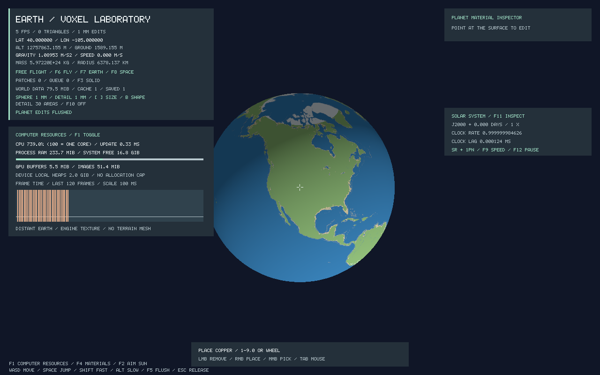
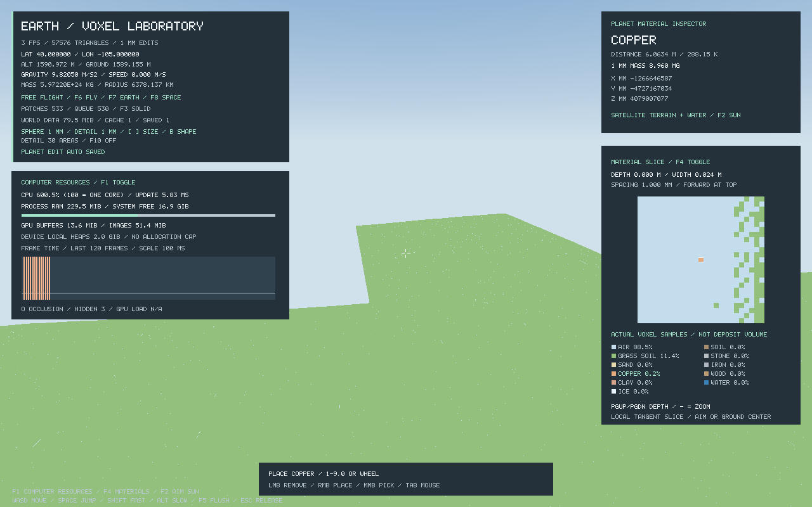
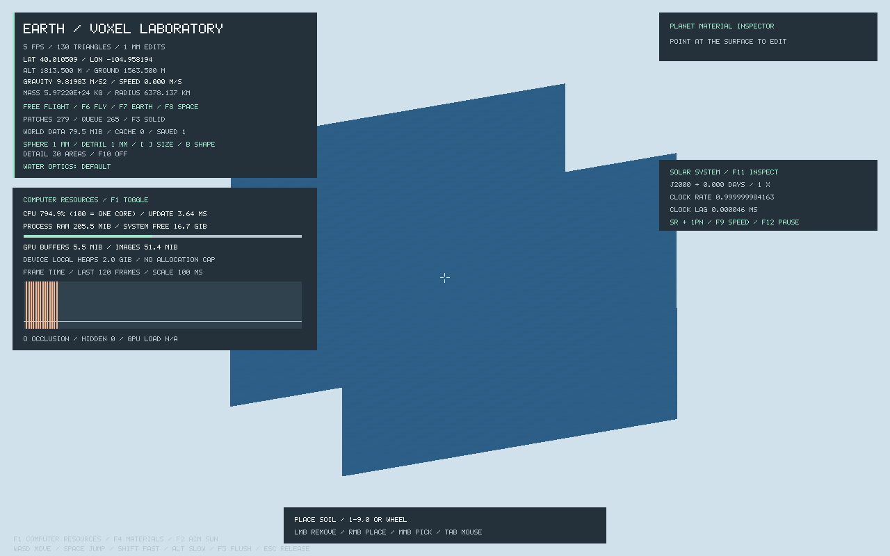

# Voxel Engine

**AI disclosure: This project was made with AI using OpenAI Codex. AI generated substantial portions of the code, shaders, tests, and documentation under the project creator's direction.**

**A proof-of-concept voxel engine aiming to simulate reality: a Matrix-like world built from editable matter and physical processes.** Written in C17 with Vulkan, it explores how millimeter-scale edits, planetary scale, and efficient mesh rendering can coexist. Earth is the current demonstration world; the long-term project is a general reality simulator. See [the project vision and current scope](PROOF_OF_CONCEPT.md).

C17 + Vulkan foundation for an editable, physically scaled planet. The default world is Earth: an oblate ellipsoid with real sampled topography and bathymetry, sparse global **1 mm edits**, dynamic surface LOD, terrain-derived textures, and gravity calculated from planetary mass and distance to its center.



The entire planet is implicit. The engine generates visible surface meshes and stores modified volumes, rather than allocating an Earth-sized voxel array. This is a simulator foundation: geography is approximate, with a nine-body Solar System, special-relativistic clocks and velocity addition, and weak-field general-relativistic orbital corrections. Earth is currently the editable terrain world; other planets are physically scaled orbital bodies with procedural appearances.

## Build and run

Requires a C17 compiler, CMake 3.20+, SQLite3 with RTree support, SDL2 development files, Vulkan headers/loader, zlib, `glslc`, and a Vulkan-capable driver. Tested on Linux with an NVIDIA GTX 1060 3 GB. The global fallback and initial fine cache are included; offline running requires no downloads.

```sh
cmake -S . -B build -DCMAKE_BUILD_TYPE=Release
cmake --build build -j4
./build/voxel_engine
```

You start on land at latitude 40°, longitude −105°. Walk, jump, place materials, and excavate. **F8 switches between the surface and a whole-Earth view.** **F6 toggles free flight. F7 aims at Earth from your current position.** Planet edits save automatically to `earth.vxp` in the working directory; the original laboratory remains available with `--lab`.

```sh
./build/voxel_engine --orbit-view
./build/voxel_engine --orbit
./build/voxel_engine --lat -33.8 --lon 151.2 --freecam
./build/voxel_engine --lat 27.99 --lon 86.93 --altitude 2000 --freecam
./build/voxel_engine --planet-save my-earth.vxp --vsync
./build/voxel_engine --help
./build/voxel_engine --lab
./build/voxel_engine --millimeter
```

`--orbit` starts a gravity-driven trajectory near 400 km altitude with an approximate circular-orbit velocity. `--orbit-view` is a stationary free-flight overview. `--altitude` is meters above sampled ground. `--view-distance` sets the surface view distance in meters; in space the range always reaches the entire planet. High-altitude spawns aim at Earth automatically. Custom `--mass KG` and `--radius M` change gravity and planet size; use a separate save for different parameters.

Rendering remains uncapped by default (`IMMEDIATE`, then `MAILBOX`, falling back to `FIFO`). Use `--vsync` to reduce rendering load. A single background meshing thread owns a separate terrain snapshot and SQLite connection. Mesh uploads stay on the render thread, and changed revisions discard obsolete results. Terrain and water draw in separate passes, ordered near to far; GPU occlusion queries skip hidden terrain when the camera is stable. Camera changes, edits, replaced meshes, and removed occluders invalidate old query results. There is no fixed FPS target or performance guarantee. Planet edit collections, tree nodes, polygon fragments, temporary meshes, and GPU buffers now grow without the previous artificial complexity/allocation caps. Available RAM/VRAM and SQLite record sizes remain finite. Distance LOD, visibility culling, and cache eviction keep the active working set local.

## Controls

| Input | Planet action |
| --- | --- |
| Mouse / WASD | Look / walk, or move in flight |
| Space | Jump; fly upward in flight |
| Ctrl | Fly downward |
| Shift | Run / faster flight |
| Alt | Slow flight to 5 mm/s for detailed work |
| Left / right / middle click | Remove / place / pick material |
| 1–9 / 0 / wheel | Select material; 9 water, 0 ice |
| [ / ] | Brush diameter/edge: 1, 5, 10, 25, 125, 250, 1000 mm |
| B | Switch sphere (default) / cube brush |
| F1 | Toggle computer resource panel (shown initially) |
| F2 | Aim at the visible Sun |
| F4 | Toggle flat material colors and local voxel slice |
| Page Up / Page Down | Shallower / deeper material slice, from 0 mm to 4,000 km |
| - / = | Narrow / widen slice: 24 mm through 240 m |
| F3 | Solid → triangle overlay → wireframe |
| F6 | Toggle fixed-orientation flight / ground-aligned walking |
| F7 | Aim at Earth without changing position |
| F8 | Whole-Earth / starting-surface view |
| F10 | Toggle background high-detail terrain downloads (enabled initially) |
| F5 | Checkpoint automatically saved planet edits |
| Tab | Capture / release mouse |
| Escape | Release mouse; again to exit |

Editing reaches 10 m. The default spherical brush avoids a cube orientation that changes relative to the local ground. Strokes through 25 mm diameter use exact 1 mm cells; larger spheres use adaptive cuboids at up to `ceil(diameter / 32)` mm boundary detail. The HUD shows the current detail. Smaller strokes can refine those cells later. Individual cells retain material and temperature. Material recipes define density, heat capacity, conductivity, and elemental fractions. Brush edits spanning chunk boundaries are saved atomically. Geometry LOD changes preserve the authoritative edits. F8 returns to the original command-line starting location. Flight captures its orientation frame when enabled: moving around the planet preserves the camera direction and horizon instead of rotating with planetary up. Mouse look changes direction; switching back to walking restores ground alignment while preserving the aim. Space/Ctrl move along the captured flight up/down axis.

F11 switches to Solar System inspection; Left/Right selects a body, F7 refocuses it, F9 cycles time acceleration, and F12 pauses orbital time. O toggles occlusion culling. V cycles clear/default/murky water optics.

## Resource views

**F1** shows process CPU usage (100% equals one fully occupied core), resident process RAM, available system RAM, tracked Vulkan buffers (including meshes, HUD, uniforms, and occlusion proxies), terrain textures and depth allocations, device-local heap capacity, and a 120-frame timing graph. GPU utilization, other applications’ GPU allocations, driver overhead, and swapchain allocations are not measured. Queue length and triangles appear in the main panel.

**F4** removes lighting from material colors and shows a 25 × 25 voxel sample slice aligned to the local ground and camera direction. It centers at the aimed surface, or the ground beneath the player. Page Up/Down changes depth; -/= changes width (the smallest width gives 1 mm sample spacing). Legend percentages count sampled cells, not total deposit volume. The scan refreshes twice per second and immediately after depth/zoom changes. It reads actual implicit layers and saved edits; a geological ore-deposit generator is not implemented. Thin features between samples can be missed.



## Scale and current limits

Earth's equatorial diameter is **12,756.274 km**, with mass **5.9722 × 10²⁴ kg**. The ellipsoid and reference mass use [NASA Earth facts](https://nssdc.gsfc.nasa.gov/planetary/factsheet/earthfact.html). Gravity outside the reference surface is `GM/r²`; equatorial sea-level gravity in this model is about **9.798 m/s²**. Falling, ground collision, jumping, and orbital integration run at 120 fixed steps per simulated second.

The global [NOAA height fallback](data/README.md) now has **5 arc-minute spacing** (about 9.3 km at the equator), with native 15-arcsecond regional maps between that fallback and fine terrain. Near the surface, the engine streams **Copernicus 30 m elevations and ESA WorldCover 10 m water masks** into small disk-cached cells. Starting cache cells cover the default Colorado location and western neighbors, part of Sydney, and part of Belém/Guamá. A global Natural Earth layer supplies **major mapped rivers worldwide**, with estimated widths until the finer satellite mask is available. Inland water now renders above sea level and supports picking and voxel edits.

Online loading is enabled by default; **F10** toggles it, or use `--terrain-offline`. Downloads run in one background process after a stable view near the surface and require **Python 3, NumPy, and GDAL CLI tools**. Cached terrain remains usable offline, and failed downloads retain the global fallback. On Unix, fine data is memory-mapped and looked up through a spatial hash, so visited areas need not remain resident in RAM. New data refreshes terrain meshes while retaining saved voxel values and coordinates.

These source datasets improve river valleys and water coverage, but they do not resolve every small or seasonal stream. Copernicus is a surface model that can include vegetation/buildings; it is not a perfect bare-ground survey. The coarse global river widths and the default 2 m channel depth are approximations. Measured land receives only small synthetic surface octaves; larger procedural relief supplements fallback terrain. See [source accuracy and attribution](data/README.md).

Surface geometry follows a six-face spherical quadtree. Greedy meshing joins adjacent coplanar equal-material edit faces, and merges smooth terrain rectangles within the current LOD error. Mesh clustering simplifies distant edit geometry while retaining the authoritative voxel data. A visible static Sun provides directional illumination, with a stylized atmosphere fading into black space; there is no day/night cycle yet. Nearby edits have exact millimeter cuboid boundaries; distant terrain uses curved surface meshes, not visible giant voxel cubes. The implicit interior is editable through the same global coordinates, with simplified iron core / stone mantle / soil surface materials. Oceans and mapped inland water have non-solid water material and static surfaces. Native water tiles now use level lake/river cross-section profiles and gradual estimated banks/beds; profiles remain local terrain-derived approximations, with cross-tile reconciliation pending. Atmospheric physics, flowing water, heat transfer, chemistry, rotation, rigid-body voxels, and changes to planetary mass from editing are future work. Player collision is a swept and sampled controller, not a complete rigid-body solver.

Greedy terrain rectangles retain neighboring boundary vertices and matching skirt endpoints to close cracks between differently sized rectangles. Rectangles with extra boundary points use the minimum polygon triangulation; an uninterrupted flat rectangle still uses two triangles. This adds geometry where needed to join surfaces while preserving mesh reduction and stored voxel values.

Terrain sampling and merging now use quantized projected error based on distance, field of view, and drawable height. Relief smaller than a screen pixel can merge instead of forcing the close-up grid across the whole view. Shader material detail remains independent of that geometry. Patches containing edit volumes currently retain finer geometry for accurate clipping. The default ground regression generates about 51,000 terrain triangles across 527 patches, compared with about 2.3 million before projected detail; this is a geometry test, not an FPS guarantee.

Turning away retains invisible terrain meshes until slot or memory pressure requires eviction, rather than discarding them after 120 frames. The planner reserves reusable patch slots before assigning new ones, and invisible GPU mesh storage has a 128 MiB LRU retention allowance; visible geometry and authoritative edit storage have independent lifetimes. F1 shows cached mesh count and memory. The regression verifies returning to 148 cached overview patches after 300 away-facing frames requires zero new mesh jobs.

During refinement, loaded coarse parents stay visible until their requested finer regions finish. Children beneath a retained parent are built in the background and promoted together, preventing holes and competing depth surfaces. Parent buffers remain cached afterward. The planner reserves parent slots before assigning replacements and coarsens requests if their combined working set does not fit. F1 reports retained coverage parents. This uses already loaded meshes; initial views without cached coverage still stream from the implicit terrain. The isolated approach check is `python3 tests/solar_window.py build/voxel_engine --handover-only`.

Static planet meshes use device-local vertex buffers. A reusable CPU-visible staging arena batches changed meshes into the frame command buffer, followed by a transfer-to-vertex-read barrier. Completed meshes stay resident and do not stream their vertex data from CPU-visible storage on every draw. The arena grows for larger uploads, preserves earlier batches during growth, and is reused after the frame fence completes. F1 includes staging memory in the tracked buffer total and identifies it separately; terrain mesh memory excludes the staging allocation.

`--render-stats` prints frame number, rendering mode, visible/pending patches, drawn triangles, cached mesh memory, and quadtree planning count twice per second. Completed stationary views reuse their existing patch selection; camera/projection changes, edits, streamed data, and world-shape changes invalidate it. The isolated Vulkan cache check is `python3 tests/solar_window.py build/voxel_engine --cache-only`; it verifies actual GPU meshes survive turning toward the Sun for at least 300 frames and returning to Earth requires no new mesh jobs.



Signed 64-bit 125 mm anchors plus local offsets retain millimeter precision. Planet queries currently have a deliberate **±2,000,000 km working range per axis**, fitting Earth comfortably; the laboratory's theoretical integer-address range is much larger. Stored edits use sparse 2 m chunks, a bounded resident cache, and disk-backed SQLite. The planet's physical size does not set RAM consumption; local edit complexity and visible geometry do. Detailed architecture, budgets, approximations, and save format are in [docs/planet.md](docs/planet.md).

## Verification

```sh
ctest --test-dir build --output-on-failure
cmake -S . -B build-asan -DVOXEL_BUILD_APP=OFF -DVOXEL_SANITIZERS=ON -DCMAKE_BUILD_TYPE=Debug
cmake --build build-asan -j4
ctest --test-dir build-asan --output-on-failure

# Optional isolated Linux input/GPU checks: Python 3, Xvfb, xdotool.
python3 tests/planet_window.py build/voxel_engine
python3 tests/window_smoke.py build/voxel_engine --millimeter
```

Planet checks additionally cover 32,768 collected regions, a 589,824-vertex exact mesh, more than 65,535 tree nodes, streaming 300 chunks through the 64-entry cache, material depth slices, resource metrics, and actual rendered visibility at 43 million meters, F7 recovery after looking away, spherical stroke coverage/persistence, and clipping round edits against oblique terrain. Planet checks cover ellipsoid conversions and coordinate seams, inverse-square gravity, global 1 mm edits and temperatures, cache eviction and reopen, eight-chunk surface seams, database rollback on injected failure, falling/grounding/jumping, orbital energy, and bounded LOD across latitudes and altitudes. The GPU test checks actual keyboard/mouse input, exact copper volume through an independent save decoder, surface/space transitions, autosave/reopen, orbital launch, and Vulkan validation when the layer is installed. Graphics checks serialize GPU access and use an isolated X display with the X11 SDL backend.

See [planetary architecture](docs/planet.md), [Earth data provenance](data/README.md), and the [original laboratory documentation](docs/laboratory.md). The old `.vxw` laboratory saves and new `.vxp` planet saves are separate formats.

## Mesh terrain and generated distant textures

Voxel matter and compressed edits remain authoritative; rendering uses cached surface meshes, following the mesh-backed voxel-terrain architecture requested. Unmodified terrain is a continuous height surface. Very close patches sample up to 128 × 128 cells, with interpolated normals and procedural material detail down to 4 mm where screen resolution permits. Natural edit surfaces share smoothed normals; manufactured materials keep hard edges. Mesh smoothing preserves voxel positions and collision geometry. This does not implement Space Engineers' full density-volume mesher: excavation boundaries still come from the stored cuboids, and large sphere strokes retain their documented adaptive voxel boundary.

The build bakes `build/earth_surface.ptex` from **the engine's own height field and material rules**. It contains elevation, engine material IDs, and inland-water classification. There is no photographic Earth colour layer. The shader filters height first, then classifies land and water, so coastlines remain sharp independently of coarse triangle/material borders. A complete analytic oblate Earth backdrop uses this same atlas above 50 km altitude, keeping the planetary silhouette intact while detailed mesh jobs arrive. The 4320 × 2160 atlas has 13 mip levels and uses roughly 49 MiB of allocated GPU memory on the tested GTX 1060. It adds visual sampling detail, not surveyed geography absent from the height sources. Global edits still render locally; the overview atlas is a base-terrain representation and is regenerated when its build inputs change.

## Solar System and relativity

```sh
./build/voxel_engine --solar-view --solar-body 4 --time-scale 86400
```

Body indices are Sun 0, Mercury 1, Venus 2, Earth 3, Mars 4, Jupiter 5, Saturn 6, Uranus 7, Neptune 8. The default epoch is J2000, restarting each launch; this is an evolving simulation, not today's ephemeris. Initial orbital elements and radii/masses follow [JPL approximate positions](https://ssd.jpl.nasa.gov/planets/approx_pos.html) and [physical parameters](https://ssd.jpl.nasa.gov/planets/phys_par.html). Earth initial elements approximate the Earth-Moon barycenter; no Moon or other satellites are simulated. All nine bodies interact gravitationally. RK4 integration uses steps no longer than one hour; F9 scales range from real time to one simulated year per real second. Navigation and Earth player physics remain interactive at normal time while the orbital clock accelerates.

Weak-field general relativity adds the leading Schwarzschild correction due to the Sun, following the [post-Newtonian acceleration model](https://www.orekit.org/site-orekit-12.2/xref/org/orekit/forces/gravity/Relativity.html). Exterior Earth player trajectories receive the corresponding Earth correction within its weak-field, low-speed range. Special relativity supplies Lorentz factors, relativistic velocity addition and approximate gravitational/velocity clock rates shown in the HUD. The regression numerically reproduces Mercury's additional perihelion advance at about 43 arcseconds per century. This is a weak-field foundation; it does not solve Einstein's field equations, include full relativistic many-body terms, lensing, gravitational waves, or strong gravity.

The Sun's observed direction and angular size now follow the orbital state. Other planets render as analytic spheres with procedural surface colours, gas-giant bands and approximate Saturn rings, without generating their full voxel surfaces. Solar positions use double barycentric meters and separate local camera offsets, keeping astronomical distances outside Earth's edit index and retaining its millimeter edit precision. Planet navigation uses true sizes; a logarithmic HUD diagram uses enlarged markers to make the bodies discoverable.

Water has a dedicated Vulkan pipeline and a `WaterOptics` interface for absorption, scattering colour, density, refractive index, waves and turbidity. Surface shading uses Fresnel reflection and Beer-Lambert attenuation over a representative optical path. V changes water appearance without changing its voxel volume. Actual volume ray integration, underwater scene rendering, buoyancy and fluid dynamics are future additions.

Distant river rendering uses projected width rather than keeping every ribbon at its near-surface detail. Ribbons smaller than 1.5 pixels are omitted; when even the widest mapped river is too small, river indexing and ribbon generation stop entirely for that patch. River tessellation also grows with pixel size. Obsolete detailed terrain buffers are discarded when entering that distant view, and invisible or outdated worker results never upload. At very large distances, where the entire terrain relief is below one pixel, solid view renders the generated terrain texture on the complete analytic Earth with **zero terrain/ribbon mesh jobs or draws**. F3 requests geometry again. This removes the dense distant-river uploads/draws responsible for the reported spikes; the resource panel identifies the texture view.
