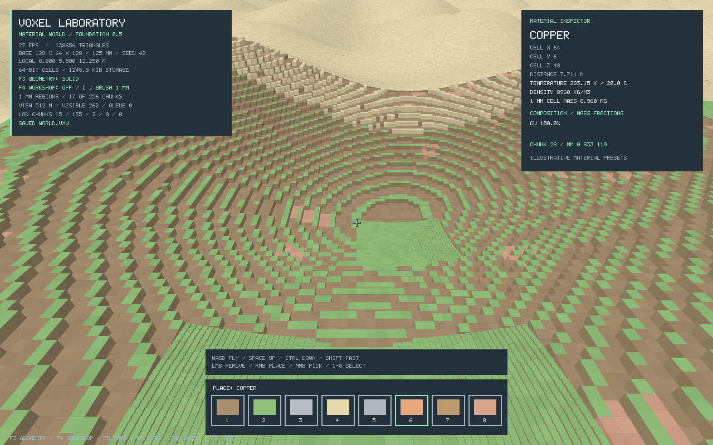
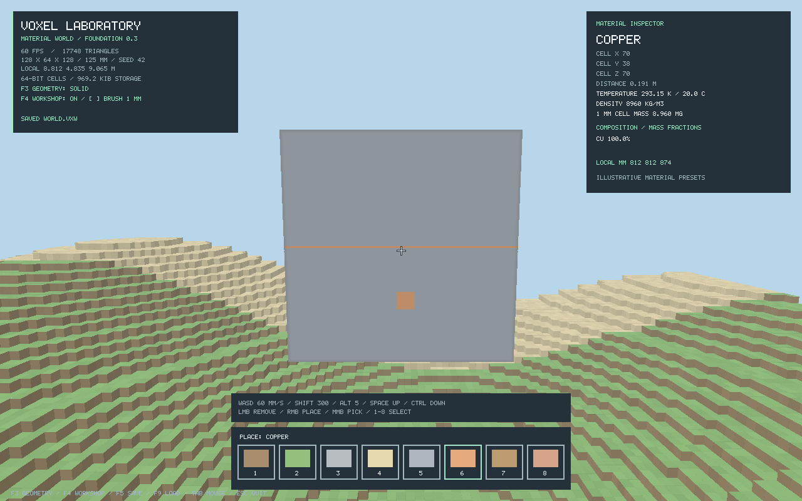

This page describes the earlier fixed laboratory, available with `--lab`. The default engine now runs an Earth-sized planet; see [planetary mode](planet.md) and the [main README](../README.md).

# Laboratory mode (legacy)

A working C17 + Vulkan starting point for a material-based voxel simulator. Fly around, inspect cells, and build or excavate the terrain. The simulation data is independent of the graphics code so we can grow it into hands-on mining, heating, shaping, mixing, and manufacturing.



## Build and run

Requires a C17 compiler, CMake 3.20+, SDL2 development files, Vulkan headers/loader, `glslc`, and a Vulkan-capable graphics driver. This first version is tested on Linux with an NVIDIA GTX 1060. No libraries are downloaded by the build.

```sh
cmake -S . -B build -DCMAKE_BUILD_TYPE=Release
cmake --build build -j
./build/voxel_engine --lab
```

Shaders compile automatically into `build/shaders`. Their build directory is compiled into the executable, so you can launch from another working directory, but moving only the executable is not supported yet. Saves go to your current working directory.

Rendering is uncapped by default: the swapchain prefers `IMMEDIATE`, then `MAILBOX`, and falls back to `FIFO` only when the surface supports neither. There is no active-window software frame limiter. Immediate presentation can tear; the display compositor or driver may still constrain throughput. The selected mode is printed at startup and on swapchain recreation. Use `--vsync` to request refresh-synchronized FIFO presentation.

## Try the 1 mm workshop

```sh
./build/voxel_engine --lab --millimeter
```

This focuses a 125 mm metal workpiece inside one refined 2-meter chunk. It has a **1 mm wide/deep groove**, a **1 mm copper stripe**, and a larger copper inlay for comparison. **Left click carves; right click fills.** The default brush is a 1 mm cube. Use **[ / ]** for 1, 5, 10, 25, or 125 mm brushes. Select **5** for iron or **6** for copper. **F4** switches between the close-up workshop and terrain view, and **F3** shows the actual geometry.

Workshop movement is 60 mm/s, Shift increases it to 300 mm/s, and Alt slows it to 5 mm/s. Tab releases/captures the mouse. F5/F9 preserve the workshop along with the world.



The default now uses **lazy generation, view-frustum culling, and dynamic LOD**. Nearby or targeted chunks retain exact millimeter geometry; distant geometry uses 125 mm through 1 m cells. A surrounding procedural terrain preview streams out to **512 m** by default, configurable up to **1024 m**. The **16 × 8 × 16 m editable area** keeps its 1 mm storage and edits. Use `--full-detail` for the earlier eager millimeter map or `--coarse` for the original 125 mm terrain. See [streaming, LOD, saves, and coordinate limits](streaming.md).

## What works

- A seeded 128 × 64 × 128 base world: 1,048,576 cells, each **125 millimeters** wide (16 × 8 × 16 meters total). Physical scale is defined in integer millimeters; global cell addresses are signed 64-bit integers.
- 256 chunks of 16³ cells. Greedy meshing combines adjacent exposed faces of the same material into rectangles; editing a boundary refreshes neighboring meshes.
- Adaptive cube storage groups regions with identical material, flags, and temperature. Editing splits the affected path; restoring matching values merges it again. Empty uniform chunks skip meshing.
- Camera-dependent generation and LOD, bounded terrain/mesh caches, and a 512 m procedural preview. Edited data remains authoritative when render detail changes.
- Adaptive 1 mm regions across the editable map, sparse surface-patch merging, exact fine/fine and fine/coarse seams, and brushes that cross chunk boundaries. Millimeter picking, highlighting, inspection, and mass reporting work throughout the detailed terrain.
- Camera positions use a 64-bit cell plus a local millimeter offset. Chunk-local vertices render relative to the camera, preserving millimeter positioning even at very large global addresses.
- Vulkan rendering with reversed-Z depth testing, directional lighting, fog, voxel outlines, target highlighting, and an asset-free HUD.
- F3 cycles solid, triangle-overlay, and wireframe views. Geometry views expose the actual triangles of the merged rectangles. Solid-view voxel grid lines are a shading effect, not extra geometry.
- A free flying camera; ray-based removal, placement, and material picking.
- Eight solid materials: soil, grass soil, stone, sand, iron, copper, wood, and clay. Air represents empty space.
- Each voxel has an independent material ID and temperature in kelvin. Materials define elemental composition by mass fraction, density, specific heat, and thermal conductivity.
- An inspector showing cell coordinates, temperature, density, estimated full-cell mass, and composition.
- Version-5 lazy-world saves containing the seed and edited regions; V3/V4 output remains for nonprocedural worlds with a metadata/payload checksum, input validation, and temporary-file replacement. Failed loads leave the current world intact. V4, V3, V2, and both V1 grids are supported; old 64 × 32 × 64 / 250 mm saves are imported by splitting each cell into eight children, preserving material, temperature, and total mass.
- Window resize/minimize/restore handling and optional Vulkan validation.

This is currently a creative editing sandbox. Temperature is stored but does not evolve. Material recipes and values are illustrative approximations. Element fractions alone do not describe chemical compounds, crystal structure, or reactions. Arbitrary mixtures, gravity, collision, fluids, heat transfer, chemistry, tools, inventories, and crafting processes are future work.

## Controls

| Input | Action |
| --- | --- |
| Mouse | Look around while captured |
| W / A / S / D | Fly horizontally |
| Space / Ctrl | Fly up / down |
| Shift | Move faster |
| Left click | Remove the targeted voxel |
| Right click | Place a voxel against the targeted face |
| Middle click | Pick the targeted material |
| 1–8 / mouse wheel | Select a material |
| F4 | Create/focus workshop, or return to terrain view |
| [ / ] | Decrease / increase millimeter brush size |
| Alt (workshop) | Slow movement to 5 mm/s |
| F3 | Cycle solid → triangle overlay → wireframe → solid |
| Tab | Capture / release the mouse |
| Escape | Release the mouse; press again to quit |
| F5 | Save to `world.vxw` |
| F9 | Load `world.vxw` |

The default camera starts above the detailed terrain; `--millimeter` starts at the workpiece. Interaction reach is 80 cells (10 m) for development. The camera can pass through terrain; placement prevents filling the camera's current cell. Losing window focus releases the mouse. Changes are saved only when requested.

```sh
./build/voxel_engine --lab --seed 123
./build/voxel_engine --lab --coarse
./build/voxel_engine --lab --full-detail
./build/voxel_engine --lab --view-distance 1024
./build/voxel_engine --lab --load world.vxw
./build/voxel_engine --lab --validation
./build/voxel_engine --lab --vsync
./build/voxel_engine --lab --origin-cell 1152921504606846976 -1152921504606846976 18014398509481984
./build/voxel_engine --lab --help
```

`--origin-cell X Y Z` translates the resident map to an exact signed 64-bit cell address. This overrides a loaded origin when passed with `--load`; it does not generate more terrain. The world origin is saved, and F9 preserves the camera position relative to the loaded map.

`--validation` enables `VK_LAYER_KHRONOS_validation` if installed and prints a notice otherwise. `--frames N` exits after N main-loop iterations; `--smoke-test` runs 120 iterations with scripted edits, resize, minimize, and restore (both start with the mouse released). Some iterations can skip drawing while minimized.

## Verification

Core checks run without a window or GPU:

```sh
ctest --test-dir build --output-on-failure

cmake -S . -B build-asan -DVOXEL_BUILD_APP=OFF -DVOXEL_SANITIZERS=ON -DCMAKE_BUILD_TYPE=Debug
cmake --build build-asan -j
ctest --test-dir build-asan --output-on-failure
```

Streaming tests check lazy data/mesh equivalence, LOD transitions, culling, tile coverage, cache eviction, V5 persistence, edit retention, camera travel, and coordinate endpoints. Full-map tests check all 256 fine chunks, generated millimeter grains, seed determinism, multi-chunk brush transactions, fine/fine seams, large-coordinate picking, and V4 saves. The millimeter tests also check exact per-grain surface coverage, randomized region edits, volume changes, temperature preservation, coalescing, mixed-resolution seams, large-address picking, and V3 persistence.

Core tests cover material fractions, exact greedy surface coverage and winding, material boundaries, chunk seams, split/coalesce correctness, independent temperatures, dirty propagation, ray traversal, millimeter offsets at global addresses above 2⁶⁰, overflow rejection, compressed save round trips, malformed trees, all legacy save formats, and forward/reversed Vulkan projection. The test binary also reports seed-42 mesh/storage statistics.

For graphics checks:

```sh
./build/voxel_engine --lab --smoke-test --validation

# Optional Linux integration test; requires Python 3, Xvfb, and xdotool.
python3 tests/window_smoke.py build/voxel_engine
python3 tests/window_smoke.py build/voxel_engine --millimeter
python3 tests/window_smoke.py build/voxel_engine --coarse
python3 tests/window_smoke.py build/voxel_engine --travel --view-distance 1024
# Also test editing and saves at an address beyond double-precision absolute integer accuracy:
python3 tests/window_smoke.py build/voxel_engine --millimeter --origin-cell 1152921504606846976 -1152921504606846976 18014398509481984
# Add --screenshot docs/preview.png for solid/overlay/wireframe previews; requires ImageMagick.
```

The integration test uses a separate X display and temporary save directory. It exercises real keyboard/mouse capture, all three geometry views, copper placement/removal, compressed persistence, 64-bit origins, workshop focus/brush controls, and clean shutdown. On the default detailed map and in workshop mode it independently decodes the saved regions and verifies that exactly 1 mm³ of copper was added. Vulkan warnings or errors fail the check; without the validation layer installed it checks behavior only.

## Code map

| File | Responsibility |
| --- | --- |
| `src/material.h`, `src/material.c` | Stable material IDs, properties, elemental recipes |
| `src/world.h`, `src/world.c` | Cell state, terrain generation, dirty chunks, ray traversal, persistence |
| `src/mesh.h`, `src/mesh.c` | Greedy coarse meshing and refined region-boundary patches |
| `src/terrain.c` | Deterministic detailed generation, procedural queries, sparse grains |
| `src/scene.h`, `src/scene.c` | Camera visibility, LOD selection, tile/cache planning |
| `src/terrain_mesh.c` | Distant surface meshes and transition skirts |
| `src/detail.h`, `src/detail.c` | Integer-mm region storage, transactional edits, fine ray picking and encoding |
| `src/position.h`, `src/position.c` | Checked 64-bit addresses and normalized millimeter offsets |
| `src/math3d.h`, `src/math3d.c` | Vector and Vulkan camera/projection math |
| `src/renderer.h`, `src/renderer.c` | Vulkan lifecycle, swapchain, buffers, synchronization, draws |
| `src/hud.h`, `src/hud.c` | Bitmap-font UI rendered with geometry |
| `src/main.c` | Application loop, camera, input and editing |
| `shaders/` | GLSL world and HUD pipelines |

The authoritative editable map remains **16 × 8 × 16 m**. Streamed preview tiles follow the camera beyond it, with a bounded working set and up to 1024 m view distance. A settled default 512 m view retained about **1.2 MiB of voxel storage** and **416,000 drawn vertices**, compared with **20.1 MiB / 1.57 million vertices** in eager full-detail mode. These are scene measurements, not FPS benchmarks; allocator overhead and meshes are additional. Vertex/HUD allocations have a **128 MiB** cap.

Signed 64-bit **125 mm base-cell** addresses provide a theoretical **2.306 × 10¹⁸ m span per axis**, about **244 light-years**, while local offsets retain millimeter precision. Coordinate capacity does not determine how much map can be stored or simulated. See [practical limits and current preview restrictions](streaming.md).

See [the architecture and next steps](architecture.md) for how this can grow into the simulator.

API references: [Khronos Vulkan documentation](https://docs.vulkan.org/) and [SDL2 Vulkan surface creation](https://wiki.libsdl.org/SDL2/SDL_Vulkan_CreateSurface). The renderer uses Vulkan 1.0 core functionality and the swapchain extension to keep the starting hardware requirements small.
