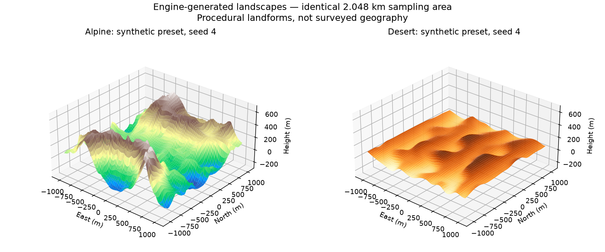

# Landscapes and engine terrain colours

The landscape sampler supplies deterministic biome, surface/subsoil/bedrock materials, temperature estimates, vegetation appearance and unresolved terrain detail. Earth rendering, voxel queries and the export tool share these rules. Measured heights and WorldCover classes take precedence; procedural additions are explicitly estimates.

## Inspect or generate a landscape

```sh
./build/landscape_generate --help
./build/landscape_generate --biome alpine --seed 4 --size 129 --spacing-mm 16000 --output alpine
./build/landscape_generate --biome desert --moisture 0.2 --output desert
./build/landscape_generate --earth-data data/earth_10min.edem --lat 40.025 --lon -104.975 --output earth-sample
```

Each invocation writes a coloured PLY mesh in local meters, a CSV with per-sample heights/material layers/source spacing/estimated climate, a PPM hillshade made from those samples, and JSON generation metadata. The same options reproduce identical files. Synthetic mode accepts seed, roughness, moisture, temperature offset and landform amplitude. Earth mode uses the actual engine recipe; generation overrides are rejected. The output directory must already exist.

Presets include ocean, freshwater, coast, desert, grassland, savanna, forest, rainforest, boreal forest, tundra, alpine, ice, wetland, urban, cropland and barren land. Ridged noise, domain warping, dune bands and approximate channel depressions provide different synthetic landforms. These are not a hydraulic erosion solver or a reconstruction of missing surveyed mountains.



Both plots use seed 4, 129 × 129 samples, 16,000 mm spacing and identical vertical scale. They visualize the generated heights, with plot colours indicating elevation.

## Measured sources and procedural estimates

[ESA WorldCover](https://esa-worldcover.org/en/about/about) provides eleven land-cover classes at 10 m nominal sampling. The engine retains those classifications in PDEM v2; older v1 packs retain their binary water mask but have unknown dry-land cover. The underlying height raster currently commonly uses Copernicus GLO-30 spacing. Land-cover sampling resolution does not imply equivalent ground-height accuracy.

Slope comes from the local height raster. Source spacing limits invented relief: coarse fallback areas can receive broad ridges, finer surveys receive much smaller additions, and the millimeter sampling limit suppresses larger invented features. Detail is sampled continuously in body-local coordinates, with a sea-level fade and no procedural displacement of water surfaces. Temperature, precipitation and geology are reproducible heuristics, not measured weather or geological maps. The sampler uses altitude, latitude, slope and continental-scale noise. [USGS landscape characterization](https://www.usgs.gov/centers/cegis/science/landscape-characterization) describes the role of relief, roughness and drainage across scales; [NPS ecosystem descriptions](https://www.nps.gov/im/sodn/ecosystems.htm) describe climate, geology and elevation as drivers of biome variation. The engine's thresholds and noise parameters are its own approximations.

Forested ground contains litter/soil over rock, while distant appearance uses canopy colours. Snow overlies ice, deserts use sand, and riverbeds contain mud/silt over rock. Ocean matter uses salt water; inland water uses freshwater. Temperature is stored in generated matter, but changing temperature still does not simulate phase transitions, weather, vegetation growth or erosion. Eight appended biome materials occupy IDs 178–185; every existing material ID remains unchanged.

## Colour detail without extra terrain faces

Coarse patches with varied land materials bake a 256 × 256 RGBA colour field in the background mesher. RGB contains engine appearance colours; level-zero alpha stores exact ground-material IDs for F4 inspection. Nine CPU-generated mip levels filter appearance with distance. Colour boundaries can therefore share greedy height triangles while wet/dry boundaries retain geometry and the separate water pipeline. Fine patches and patches intersecting voxel edits retain material-specific geometry.

The renderer reserves three arrays of 256 layers, one layer per cached patch slot, requiring about **256 MiB of GPU texture capacity** (258 MiB allocated on the GTX 1060), in addition to the roughly 49 MiB whole-Earth atlas and geometry/depth/staging allocations. Arrays respect Vulkan's guaranteed minimum of 256 layers. Allocation is currently fixed at startup, including laboratory mode; making it demand-driven is an optimization opportunity. F1 shows tracked image memory and cached biome fields/upload counts. These counters are allocations, not a driver-wide utilization measurement.

Geometry, mapping and colour payload upload together before drawing. Old parents remain until their complete replacement meshes and colours are ready. Texture layers remain with cached mesh slots through camera turns and are overwritten only when that slot receives a replacement. The upload arena grows before taking write pointers and preserves pending payloads; transfer-to-fragment and transfer-to-vertex barriers protect both consumers.

The standard 527-patch ground fixture uses **162,777 vertices (54,259 triangles)** with biome detail, compared with 407,256 vertices when material boundaries split geometry. Cold CPU generation takes about 10 seconds for the entire fixture on the development machine; actual jobs stream in a background thread. The GPU/input test checks multiple colour uploads, distinct ground colours and clean Vulkan synchronization validation. This is geometry evidence, not a desktop FPS benchmark. First-view gaps before any parent loads and expensive geometry around edits remain separate tasks.

The overview atlas is built from the same engine's measured height and biome appearance rules. Neither texture path uses photographic Earth imagery. The atlas follows build inputs and does not yet rebake itself when an on-demand source arrives during a running session; local patch textures follow source revisions.
