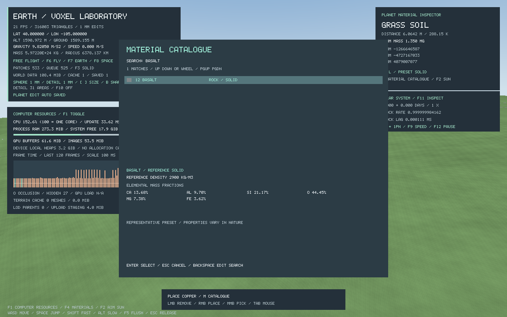

# Elements and composition foundations

The C core has the full 118-element catalogue, including identities, source atomic masses, reference densities, source melting/boiling points, standard states and group classifications. Data is imported from [PubChem](https://pubchem.ncbi.nlm.nih.gov/rest/pug/periodictable/JSON); see [snapshot provenance and limitations](../data/elements/README.md). Missing measurements stay unknown and predicted states stay marked. Element properties are reference metadata, not a thermodynamics simulation.

Inspect the catalogue offline:

```sh
./build/element_catalog
./build/element_catalog Fe
./build/element_catalog Og
python3 tools/import_elements.py --check
```

`element_get`, `element_by_number`, and `element_find` expose the table. Element enum IDs follow atomic number minus one. Save files continue to store stable material IDs; the original eleven materials retain IDs 0–10. Air now has a dry-air elemental mass recipe. All 178 IDs pass uniform-voxel encode/decode checks with temperatures preserved.

`composition.h` provides a practical basis for geological recipes. `composition_from_atoms` converts stoichiometric ratios into elemental mass fractions using the imported atomic masses. `composition_from_fractions` normalizes supplied fractions and merges duplicate elements. `composition_mix` combines valid compositions using mass weights. Recipes hold up to 16 distinct elements and reject invalid/overflowing values or excessive diversity without replacing the caller's previous result.

```c
AtomRatio quartz_atoms[] = {{E_SI, 1}, {E_O, 2}};
Composition quartz;
if (composition_from_atoms(&quartz, quartz_atoms, 2)) {
    double silica_silicon_fraction = composition_fraction(&quartz, E_SI);
    /* About 46.74% of this SiO2 composition is silicon by mass. */
}
```

`material_composition` extracts normalized fractions from a material recipe. Every preset, including air, now has a normalized elemental recipe. Temperature/pressure phase queries and reactive air chemistry remain work in progress. A physical-state enum includes unknown, solid, liquid, gas, and plasma, but changing a voxel's temperature does not yet melt, evaporate, react, or move it.

These helpers preserve mass accounting, but a mixture of H and O does not establish whether it is water, dissolved gas, or separate phases. Future simulation must retain species/mineral phase identity and track reaction energetics independently from elemental fractions.


## Expanded material catalogue



There are 60 ordinary presets (including the original eleven) and 118 elemental placement presets. Common geological families include granite, basalt, limestone, sandstone, shale, marble, slate, gneiss, quartzite, peridotite, obsidian, pumice, tuff, gravel, silt, chalk, regolith, peat and mud. Sand presets include quartz-rich, carbonate, red/iron-bearing and volcanic varieties. Mineral endmembers include quartz, calcite, dolomite, potassium feldspar, anorthite plagioclase, forsterite olivine, diopside pyroxene, muscovite mica, kaolinite, gypsum, halite, hematite, magnetite, pyrite and sulfur.

These are **representative recipes**, not a claim that every rock or deposit has one universal composition. [USGS rock/mineral definitions](https://www.usgs.gov/faqs/what-difference-between-a-rock-and-a-mineral) explain the distinction between mineral species and rock aggregates. Geological mixtures are encoded as mineral mass weights; selected mineral endmembers are encoded with atom counts. [USGS calcium-bearing mineral examples](https://pubs.usgs.gov/sir/2017/5118/elements/Calcium/Ca_txt.html) describe carbonate/gypsum formulas and their geological setting. `data/materials/recipes.json` is the inspectable source; `tools/import_materials.py` converts its recipes using the imported atomic masses and generates stable C IDs, data and the GLSL palette count together. This pass supplies a useful extensible set, rather than claiming to enumerate every known mineral, isotope or allotrope.

Water/ice/snow/vapor, salt water, methane gas/ice/liquid, ammonia gas/ice, carbon-dioxide gas/ice and lava provide explicit state presets. The preset's reference state determines current collision behavior. Stored temperature does not automatically change the preset, trigger reactions, or move fluid. Placement currently uses the editor's existing temperature; state presets are not equilibrium declarations at that temperature.

Elemental presets keep source density where available. Missing density, heat capacity or conductivity remains `NAN`, with “unknown” displayed in the tools/UI. Element colours use PubChem's CPK identification palette (neutral gray when missing); they are inspection colours, not measured bulk reflectance. Predicted standard states stay labeled in the picker. Static painted gas/fluid boundaries are previews of stored matter, not a volumetric-flow renderer; legacy laboratory meshing still omits non-solid surfaces.

Press **M** in either editor, type a material name/family or element symbol, use Up/Down or the wheel, and press Enter to select. Escape cancels and restores the prior material. Search tokens combine, so `element Og` selects Oganesson; one/two-letter element symbols match that element rather than a substring in other names. The picker releases/restores mouse capture and prevents typing from moving the camera or editing terrain. The legacy tray shows one page around the selected material, and the resource legend shows up to twelve sampled materials rather than the whole catalogue.

```sh
./build/material_catalog
./build/material_catalog "Granite"
./build/material_catalog "Oganesson (element)"
python3 tools/import_materials.py --check
```

The original key shortcuts retain their material mapping; the wheel can traverse the expanded catalogue. New saves containing added IDs need this or a newer engine build. The on-GPU colour palette grows to 178 entries; C and GLSL share the generated count, and the uniform layout is asserted. Terrain atlas material IDs still fit the current byte encoding. New natural mineral/rock presets participate in edit-normal smoothing; metallic/elemental presets retain hard normals.
